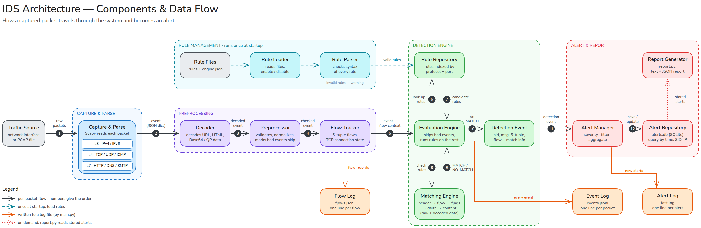

# Python Signature-based IDS

Hệ thống phát hiện xâm nhập (IDS) dựa trên chữ ký: bắt packet từ card mạng hoặc
file PCAP, phân tích và giải mã nội dung, theo dõi từng kết nối, rồi so với bộ rule
cú pháp Snort. Kết quả khớp rule được chuyển thành cảnh báo có phân loại mức độ, được
lọc và gom nhóm để tránh ngập alert, lưu vào SQLite và tổng hợp thành báo cáo. Log
được ghi dạng JSON Lines để công cụ khác (SIEM, script, `jq`) đọc tiếp.

## Architecture




Hệ thống có ba luồng:

**Lúc khởi động (nét đứt):** rule được nạp **một lần**. Loader đọc file `.rules`,
Parser dịch từng rule sang dạng máy so được và loại rule viết sai, Repository xếp
rule hợp lệ theo protocol + port để tra nhanh.

**Với mỗi packet (nét liền, đánh số):**

| Step | Component | Responsibility |
|---|---|---|
| 1–2 | **Capture & Parse** | Scapy bắt packet; tách IP (L3), TCP/UDP/ICMP (L4), HTTP/DNS/SMTP (L7) thành một **event** dạng JSON |
| 3 | **Decoder** | Giải mã dữ liệu bị ngụy trang: URL `%27` (kể cả mã hóa nhiều lớp `%2527`), HTML entity, Base64, Quoted-Printable, form body |
| 4 | **Preprocessor** | Kiểm tra và chuẩn hóa event; event hỏng hoặc ngoài chính sách bị đánh dấu `skip` |
| 5 | **Flow Tracker** | Gom packet thành kết nối (5-tuple), biết chiều client→server và trạng thái TCP |
| 6–7 | **Evaluation Engine ⇄ Rule Repository** | Bỏ qua event `skip`; lấy các rule *liên quan* tới protocol/port của packet |
| 8–9 | **Matching Engine** | So từng rule theo thứ tự `header → flow → flags → dsize → content`, sai bước nào dừng ở bước đó |
| 10 | **Detection Event** | Mỗi rule khớp sinh một Detection Event (rule, 5-tuple, flow, vị trí khớp) |
| 11 | **Alert Manager** | Kiểm tra event, gán severity theo priority, lọc theo severity/suppress, gom event lặp trong một cửa sổ thời gian |
| 12 | **Alert Repository** | Lưu alert vào SQLite (`alerts.db`); alert được gộp thêm event thì cập nhật `count`/`last_seen` |

**Khi cần báo cáo (nét chấm):** `report.py` đọc Alert Repository theo khoảng thời gian
và sinh báo cáo text + JSON. Report chỉ đọc alert đã lưu, không cần packet hay rule.

Song song đó, mọi event được ghi vào `events.jsonl`, mỗi kết nối được ghi vào
`flows.jsonl` ngay khi nó đóng (kết nối còn mở được ghi lúc chương trình kết thúc), mỗi
alert mới được ghi một dòng ngắn vào `fast.log`.

### Design Rationale

- **Decoder đứng trước Engine:** kẻ tấn công thường mã hóa payload. `%27%20OR%201%3D1`
  chỉ khớp rule `content:"' OR 1=1"` sau khi được giải mã. Matcher tìm content
  trong payload gốc **và** trong dữ liệu đã giải mã.
- **Flow Tracker đứng trước Engine:** rule như `flow:to_server,established` cần biết
  packet đi chiều nào và kết nối đã bắt tay xong chưa — một packet đơn lẻ không cho
  biết điều đó.
- **Rule được biên dịch sẵn lúc khởi động:** dịch biến (`$HTTP_PORTS`), hex
  (`|0d 0a|`), dải IP chỉ làm một lần; rule sai bị báo ngay thay vì làm hỏng lúc chạy.
- **Index theo protocol + port:** packet DNS port 53 không phải thử rule HTTP port 80.
- **Matcher kiểm tra từ rẻ đến đắt:** so IP/port trước, tìm chuỗi trong payload sau
  cùng, nên đa số rule bị loại trước khi phải tìm chuỗi.
- **Tách Detection Event khỏi Alert:** Core Engine chỉ báo "rule nào khớp ở đâu".
  Severity, lọc, gom nhóm là việc của Alert Manager. Đổi chính sách cảnh báo không phải
  đụng tới engine, và chạy lại được trên Detection Event cũ (`-D`) mà không cần pcap.
- **Gom nhóm theo giờ packet:** khóa `(sid, src_ip, dst_ip)`, cửa sổ tính theo timestamp
  của packet chứ không theo đồng hồ máy. Một đợt quét 1000 packet thành một alert có
  `count = 1000`, và đọc lại cùng pcap luôn ra cùng kết quả.
- **SQLite cho Alert Repository:** có sẵn trong Python, truy vấn theo thời gian/SID/IP
  bằng index, cập nhật `count` tại chỗ. Mỗi alert được commit ngay nên IDS dừng đột ngột
  cũng không mất alert.
- **Không có module nào làm dừng hệ thống:** packet hỏng, rule sai, file rule thiếu,
  Detection Event thiếu trường đều chỉ sinh cảnh báo kèm lý do.
- **Chạy lâu không phình bộ nhớ:** flow đã đóng được ghi ra file ngay rồi bỏ khỏi
  RAM; việc tìm content ghi nhớ các lần thử thất bại nên payload do kẻ tấn công dựng
  không làm engine đứng.

## Components

| Component | File | Notes |
|---|---|---|
| CLI, capture, ghép pipeline | `src/main.py` | Gọi lần lượt các module, ghi file đầu ra |
| Parser L3 / L4 / L7 | `src/parse_network.py`, `parse_transport.py`, `parse_application.py` | IPv4/IPv6; TCP/UDP/ICMP; HTTP/DNS/SMTP |
| Decoder | `src/decoder.py` | `uri_decoded`, `text_decoded`, `body_decoded` + trạng thái decode |
| Preprocessor | `src/preprocessor.py` | `valid/partial/invalid`, `continue/skip`, dữ liệu đã chuẩn hóa |
| Flow Tracker | `src/flow_tracker.py` | 5-tuple, trạng thái TCP, idle timeout, thống kê flow |
| Rule Loader | `src/rule_loader.py` | Đọc nhiều file `.rules`, bỏ comment, nối dòng `\`, bật/tắt theo config |
| Rule Parser | `src/rule_parser.py` | Rule text → Rule Object; phân loại `valid / invalid / unsupported` |
| Rule Repository | `src/rule_repository.py` | Lưu rule hợp lệ, index theo protocol + port |
| Evaluation Engine | `src/engine.py` | Lấy rule ứng viên, gọi matcher, thống kê |
| Matching Engine | `src/rule_matcher.py` | `MATCH / NO_MATCH` + bước bị loại + lý do |
| Detection Event Generator | `src/detection.py` | Detection Event theo schema cố định |
| Alert Manager | `src/alert.py` | Kiểm tra input, `alert_id`, severity, lọc, gom nhóm |
| Alert Repository | `src/alert_store.py` | SQLite: lưu, cập nhật alert gộp, truy vấn |
| Report Generator | `src/report.py` | Thống kê theo khoảng thời gian, xuất text + JSON |

## Getting Started

Yêu cầu Python 3 và Scapy.

```bash
python3 -m venv .venv
.venv/bin/pip install scapy
```

Cách dùng giống Snort/Suricata: chọn nguồn packet, trỏ tới file cấu hình, kết quả
ghi vào một thư mục log.

```bash
# đọc file PCAP
.venv/bin/python src/main.py -r capture.pcap -c rules/engine.json

# giám sát trực tiếp trên card mạng (cần root, dừng bằng Ctrl+C)
sudo .venv/bin/python src/main.py -i eth0 -c rules/engine.json -l /var/log/ids

# chỉ kiểm tra bộ rule rồi thoát
.venv/bin/python src/main.py -T -c rules/engine.json

# chạy lại Alert Module trên Detection Event đã lưu (vd sau khi chỉnh suppress)
.venv/bin/python src/main.py -D logs/detections.jsonl -c rules/engine.json -l retune
```

| Option | Description |
|---|---|
| `-r PCAP` / `-i IFACE` | Đọc file PCAP hoặc bắt trực tiếp trên card mạng |
| `-D JSONL` | Đọc Detection Event đã lưu, chỉ chạy Alert Module |
| `-c CONFIG` | File cấu hình: rule, biến, timeout, chính sách (xem mục Configuration) |
| `-s RULES` | Nạp thêm file `.rules`, lặp lại được |
| `-l DIR` | Thư mục log, mặc định `logs/` |
| `-n N` | Dừng sau N packet, mặc định không giới hạn |
| `-T` | Chỉ nạp và kiểm tra rule rồi thoát |
| `-v` | In alert (và event bị lọc/từ chối) ra console, ghi thêm `trace.jsonl` và `rules_report.jsonl` |

Cảnh báo khi nạp rule, thống kê engine và thống kê Alert Manager được in ra stderr.

### Reports

```bash
# báo cáo toàn bộ alert trong thư mục log mặc định
.venv/bin/python src/report.py -c rules/engine.json

# một ngày, chỉ alert HIGH từ một nguồn, Top 10, chia theo phút
.venv/bin/python src/report.py -c rules/engine.json --from 2025-11-15 --to 2025-11-15 \
    --severity HIGH --src 203.0.113.10 -n 10 --bucket minute

# liệt kê Alert Object khớp truy vấn (JSON Lines) thay cho báo cáo
.venv/bin/python src/report.py -c rules/engine.json -a --sid 1000001
```

| Option | Description |
|---|---|
| `-c CONFIG`, `-l DIR` | Giống `main.py`: tìm `alerts.db` và đọc `report.top_n` |
| `--from`, `--to` | Khoảng thời gian (UTC): `2025-11-15`, `"2025-11-15 08:00"`, ISO 8601 hoặc epoch; `--to` chỉ có ngày/phút tính tới hết ngày/phút đó |
| `--severity`, `--sid` | Lọc theo severity / SID, lặp lại được |
| `--src`, `--dst`, `--protocol` | Lọc theo source IP, destination IP, protocol |
| `-n N` | Số dòng Top-N, ghi đè `report.top_n` |
| `--bucket hour\|minute` | Thống kê alert theo giờ hoặc theo phút |
| `-o FILE` | File báo cáo JSON, mặc định `<thư mục log>/report.json` |
| `-a` | In danh sách Alert Object thay cho báo cáo |

Báo cáo text in ra stdout, bản JSON ghi ra file; hai bản dựng từ cùng dữ liệu nên số
liệu luôn khớp. Khoảng thời gian không có alert vẫn cho báo cáo rỗng hợp lệ.

```
IDS SECURITY REPORT
Period: 2025-11-15T00:00:00Z -> 2025-11-15T23:59:59Z (UTC)
Total alerts: 10 (events: 20) | Critical: 3 | High: 5 | Medium: 2 | Low: 0
Top SID: 1000011 (5) | Top source: 203.0.113.10 (15)
```

Sau phần tổng quan là các bảng: Severity, Top SID, Classtype, Top source/destination IP,
Transport/Application protocol, Alerts per hour (hoặc minute). `alerts` là số alert sau
gom nhóm, `events` là số Detection Event thật; bảng Top-N xếp theo `events`.

## Output

Mọi file nằm trong thư mục log (`-l`):

| File | One line per |
|---|---|
| `events.jsonl` | Một packet đã xử lý (event) |
| `detections.jsonl` | Một Detection Event: một lần rule khớp (khi có rule) |
| `alerts.db` | Alert Repository (SQLite): bảng `alerts` và bảng `discarded` (event bị lọc/từ chối kèm lý do) |
| `fast.log` | Một alert mới, dạng một dòng ngắn |
| `flows.jsonl` | Một kết nối, ghi ngay khi kết nối đóng, kèm số packet/byte và lý do kết thúc |
| `trace.jsonl` | (`-v`) Rule ứng viên và kết quả MATCH/NO_MATCH của từng event |
| `rules_report.jsonl` | (`-v`) Trạng thái và lý do của từng rule |

**Event** gồm 7 phần, mỗi phần do một module điền:

| Section | Module | Content |
|---|---|---|
| `packet_id`, `timestamp` | `main.py` | Thứ tự và thời điểm packet |
| `network` | parser L3 | `src_ip`, `dst_ip`, `ttl`, `ip_length` |
| `transport` | parser L4 | Port, cờ TCP, `payload_length`, `payload_b64` |
| `application` | parser L7 | HTTP method/path/header/body, DNS query/answer, lệnh SMTP |
| `decoder` | Decoder | Dữ liệu đã giải mã, `decode_method`, `decode_status` |
| `preprocess` | Preprocessor | `preprocess_status`, `processing_action`, `reason`, `normalized` |
| `flow` | Flow Tracker | `flow_id`, `direction`, `state` |

Thiếu dữ liệu thì field là `null`, list là `[]`.

**Detection Event** (đầu ra của Core Engine) ví dụ:

```json
{"timestamp": 1700000003.0, "packet_id": 4, "sid": 100001, "rev": 1,
 "msg": "Directory traversal detected", "priority": 1, "classtype": "web-application-attack",
 "protocol": "TCP", "application_protocol": "HTTP",
 "src_ip": "10.0.0.5", "src_port": 52133, "dst_ip": "192.168.1.20", "dst_port": 80,
 "flow_id": "flow-0001", "flow_direction": "forward", "flow_state": "ESTABLISHED",
 "match": {"contents": [{"content": "../", "buffer": "payload", "offset": 12, "nocase": false}],
           "flow": {"direction": "to_server", "state": "established"}}}
```

`match` cho biết rule khớp ở đâu: content nào, trong vùng dữ liệu nào (`payload`
hay `uri_decoded`...), ở vị trí nào.

**Alert** (sau Alert Manager, lưu trong `alerts.db`) ví dụ:

```json
{"alert_id": "A000001", "sid": 4070001, "rev": 1, "msg": "Directory traversal",
 "severity": "CRITICAL", "priority": 1, "classtype": "web-application-attack",
 "protocol": "TCP", "application_protocol": "HTTP",
 "src_ip": "10.0.0.5", "src_port": 52133, "dst_ip": "192.168.1.20", "dst_port": 80,
 "flow_id": "flow-0001", "packet_id": 4,
 "first_seen": 1763164803.0, "last_seen": 1763164845.0, "count": 5,
 "status": "ok", "reason": null}
```

5 Detection Event cùng `(sid, src_ip, dst_ip)` trong 42 giây được gộp thành một alert.
`status = "partial"` khi một trường phụ sai và bị bỏ; `reason` ghi trường đó.

`fast.log`:

```
2025-11-15T00:00:03Z [CRITICAL] A000001 [sid:4070001:1] "Directory traversal" TCP 10.0.0.5:52133 -> 192.168.1.20:80
```

## Writing Rules

Rule dùng cú pháp Snort, mỗi rule một dòng (hoặc nối dòng bằng `\`):

```
alert tcp any any -> any $HTTP_PORTS (msg:"SQL injection OR 1=1"; flow:to_server,established; content:"' OR 1=1"; nocase; sid:1000002; rev:1;)
```

| Part | Supported |
|---|---|
| Action | `alert` |
| Protocol | `tcp`, `udp`, `ip` |
| IP | `any`, IPv4, CIDR, `[list]`, `!`, biến `$HOME_NET`... |
| Port | `any`, `80`, `1:1024`, `[80,443]`, `!`, biến `$HTTP_PORTS`... |
| Chiều | `->`, `<>` |
| Thông tin | `msg`, `sid` (bắt buộc), `rev`, `classtype`, `priority`; `reference`/`metadata` được bỏ qua |
| Điều kiện | `content` (cả `\|hex\|`) với `nocase`, `offset`, `depth`, `distance`, `within`; `flags`; `dsize`; `flow` (`to_server`, `to_client`, `established`, `not_established`) |

Rule dùng tính năng chưa hỗ trợ (`pcre`, `byte_test`, `icmp`, action `drop`...) được
đánh dấu `unsupported` và bỏ qua; rule sai cú pháp bị đánh dấu `invalid`. Cả hai chỉ
sinh cảnh báo, không làm dừng hệ thống.

## Configuration

Mọi thiết lập nằm trong một file JSON truyền bằng `-c` (bản mặc định: `rules/engine.json`).
Không có `-c` thì IDS chạy không rule, với timeout và chính sách mặc định như bên dưới.
Đổi hành vi IDS bằng cách sửa file này, không cần sửa code hay thêm tham số dòng lệnh.

```json
{
  "rule_files": [{"path": "local.rules", "enabled": true}],
  "disabled_sids": [],
  "variables": {"HOME_NET": "any", "EXTERNAL_NET": "any", "HTTP_PORTS": "[80,8000,8080,8888]"},
  "flow_timeout": {"tcp": 300, "udp": 60},
  "skip_unknown": false,
  "max_payload": null,
  "alert": {
    "severity_map": {"1": "CRITICAL", "2": "HIGH", "3": "MEDIUM", "4": "LOW"},
    "min_severity": "LOW",
    "suppress": [],
    "aggregation": {"enabled": true, "window": 60},
    "storage": {"type": "sqlite", "path": null}
  },
  "report": {"top_n": 5}
}
```

| Key | Description |
|---|---|
| `rule_files` | File rule cần nạp (đường dẫn tính từ thư mục chứa file cấu hình), bật/tắt từng file |
| `disabled_sids` | Tắt từng rule theo `sid` |
| `variables` | Giá trị các biến dùng trong rule (`$HOME_NET`, `$HTTP_PORTS`...) |
| `flow_timeout` | Số giây không có packet trước khi đóng flow TCP / UDP |
| `skip_unknown` | `true`: không đánh giá event có protocol ứng dụng `UNKNOWN` |
| `max_payload` | Không đánh giá payload lớn hơn N byte (`null` = không giới hạn) |
| `alert.severity_map` | Priority của rule → severity. Mỗi khóa là đầu một khoảng (`"4"` = 4 trở lên); rule không có priority nhận mức của khóa lớn nhất |
| `alert.min_severity` | Bỏ alert nhẹ hơn mức này |
| `alert.suppress` | Danh sách mục `{"sid", "src_ip", "dst_ip", "protocol"}` (IP nhận CIDR); alert khớp mọi trường của một mục thì bị bỏ |
| `alert.aggregation` | Gộp event cùng `(sid, src_ip, dst_ip)` trong `window` giây; `enabled: false` để mỗi event một alert |
| `alert.storage` | `path: null` = `<thư mục log>/alerts.db`, tạo mới mỗi lần chạy; đặt đường dẫn riêng (tính từ thư mục chạy lệnh) để có kho lâu dài, giữ alert qua các lần chạy |
| `report.top_n` | Số dòng trong các bảng Top-N của báo cáo |

Khóa bỏ trống thì dùng giá trị mặc định ở trên. Khóa sai tên hoặc sai kiểu (ví dụ
`"max_payload": "200"`) bị báo lỗi ngay khi khởi động, IDS không chạy với cấu hình sai.

Bộ rule mẫu `rules/local.rules` phát hiện: directory traversal, SQL injection, XSS,
truy cập `/etc/passwd`, quét SYN/NULL/XMAS, truy vấn DNS tên miền `.xyz`, lệnh SMTP `EXPN`.

## Project Structure

```
src/        mã nguồn (bảng Components ở trên)
rules/      local.rules (bộ rule mẫu), engine.json (cấu hình mặc định)
assets/     sơ đồ kiến trúc (.png + .excalidraw)
TEST/       testcase: input.pcap tái tạo được + kết quả thực tế + report.md
docs/       tài liệu tham khảo cho các hướng phát triển
test.py     công cụ trích packet theo protocol từ một PCAP lớn để làm testcase
```

`test.py` cần file `ultimate_wireshark_protocols_pcap_220213.pcap` (87 MB) ở thư mục
gốc. File này không nằm trong git; tải riêng và đặt vào đó.

## Testing

Mỗi testcase là một thư mục có `gen_input.py` (sinh `input.pcap` hoặc `input.jsonl`
với timestamp cố định), kết quả thực tế (`events.jsonl`, `detections.jsonl`, `fast.log`,
báo cáo...) và `report.md` (lệnh chạy, input, kết quả mong đợi). Một số testcase có
`verify.py` tự đối chiếu kết quả. `alerts.db` không commit; xem nội dung bằng
`report.py -a` (đã lưu sẵn thành `alerts.jsonl` trong testcase).

| Directory | Covers |
|---|---|
| `TEST/Bai-tap-01/` | Capture & Parse: TCP handshake, HTTP, DNS, SMTP, protocol lạ, packet hỏng |
| `TEST/Bai-tap-02/T01–T06, T14, T16, T17` | Decoder và Preprocessor: URL/HTML/MIME decode, chuẩn hóa, event hỏng, chính sách skip |
| `TEST/Bai-tap-02/T07–T13, T15` | Flow Tracker: handshake, hai chiều, đóng kết nối, UDP, nhiều flow, timeout, thống kê |
| `TEST/Bai-tap-03/T01–T06` | Nạp rule: loader, rule sai, keyword chưa hỗ trợ, header, chiều, index |
| `TEST/Bai-tap-03/T07–T14` | So khớp: header, flow, content/nocase, offset/depth, distance/within, flags/dsize, nhiều rule, Detection Event |
| `TEST/Bai-tap-04/TC01–TC03` | Alert Manager: Alert Object, priority → severity, event thiếu trường |
| `TEST/Bai-tap-04/TC04–TC08` | Lọc theo severity/SID, gom nhóm trong và ngoài cửa sổ |
| `TEST/Bai-tap-04/TC09–TC10` | Alert Repository: lưu bền vững, đọc lại, truy vấn |
| `TEST/Bai-tap-04/TC11–TC14` | Report: severity, Top SID/IP, protocol/thời gian, đối chiếu text + JSON |

Chạy lại một testcase:

```bash
.venv/bin/python TEST/Bai-tap-02/T01_HTTP_URL_Decode/gen_input.py
.venv/bin/python src/main.py -r TEST/Bai-tap-02/T01_HTTP_URL_Decode/input.pcap \
    -n 20 -l TEST/Bai-tap-02/T01_HTTP_URL_Decode
```

Lệnh cụ thể của từng testcase nằm trong `report.md` của thư mục đó.

## Roadmap

Các hướng mở rộng tiếp theo (tham khảo thêm `docs/`):

- Response: gửi alert mức cao qua email/webhook, chặn kết nối (IPS).
- Threshold theo tần suất (vd chỉ cảnh báo khi một nguồn vượt N lần/phút), khôi phục
  nhóm aggregation khi khởi động lại với kho lâu dài.
- Mở rộng rule: `pcre`, `http_uri`, `byte_test`, ICMP, IPv6.
- Tái hợp TCP stream để phát hiện tấn công trải trên nhiều packet.


## AI Usage

| Model | Hỗ trợ |
|---|---|
| Big Pickle (OpenCode) | Parser HTTP/DNS/SMTP (`parse_application.py`), `test.py` |
| mimo-v2.6-flash (omp) | Decoder, Preprocessor, Flow Tracker và phần ghép pipeline |
| Claude Opus 5.5 (Claude Code) | Detection engine (`rule_*.py`, `engine.py`, `detection.py`), Alert & Report (`alert.py`, `alert_store.py`, `report.py`), testcase engine và alert/report, sửa lỗi và audit, cấu trúc `main.py` + CLI, sơ đồ kiến trúc, README |
